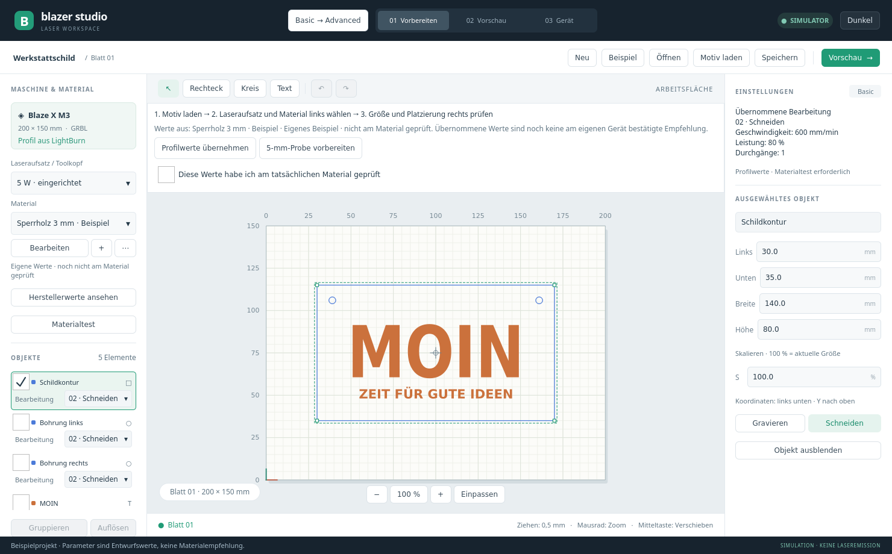

# Blazer Studio

Linux-Anwendung zum Vorbereiten und Steuern von Laserjobs auf Mathias’ BlazerX. Die Oberfläche orientiert sich an Aufbau und Bediengefühl von OrcaSlicer.

**Status:** 0.9.0-beta.3 als geprüfter Software-Testkandidat für Ubuntu 26.04 / x86_64. Neu: Debian-Paket mit passendem Quellarchiv, Erststartführung, Hilfe / Beta und freiwilliger lokaler Diagnoseexport. Geräte-/Materialabnahme und externe Einsteigertests sind offen. C++20 / Qt Quick: abbrechbare Hintergrundberechnung für Jobs und CSV-Stapel, abgesicherte Dateispeicherung und Wiederherstellung; Basic/Advanced mit geführtem Einstieg und Tooltips, Originalbilder bis 4096 × 4096 sowie speichersparendere Rasterverarbeitung; weiterhin Editor mit Pfadwerkzeugen, freie zusätzliche Operationen und Arbeitsblätter, Autosave/Wiederherstellung, Bild-/Vektorimporte, Schnitt-/Scanoptionen, Serienexport und Relief mit 16-Bit-/3D-/lokaler Foto-Tiefenschätzung. Verbindung, Referenzfahrt und erste reale Kraftpapier-Kontur-/Rasterversuche am M3 sind bestätigt; vollständige Betriebs-, Schnitt- und Reliefabnahme stehen aus.

**Neu seit beta.2:** `0.9.0-beta.3` ergänzt [Projektname, Notizen, Vorlagen und Dateiverlauf](docs/PROJECTS.md) mit Projektformat 8. Der [geprüfte beta.3-Kandidat](docs/beta/CANDIDATE_BETA3.md) stammt aus Revision `4da2e97`. Der unveränderte beta.2-Kandidat bleibt auf Revision `18ce2e6`. Geräte-/Materialabnahme und externe Bedienung bleiben offen.

**Entwicklung nach beta.3:** `0.9.0-beta.4-dev` ergänzt vollständige Blattkopien, eine eindeutige aktive Ausgabe, den sichtbaren Bearbeitungsverlauf und begrenzte [HPGL/PLT-, GCode-, RDWorks-Job- und begrenzte MillMage-Geometrieimporte](docs/VECTOR_IMPORTS.md). Zusätzlich stehen [Bildexporte mit und ohne Korrekturen](docs/RASTER_EXPORTS.md) als PNG/JPEG/BMP bereit. [Kopieren und Einfügen über die Systemzwischenablage](docs/CLIPBOARD.md) ergänzt die Objektbedienung. [Millimeter-/Zollbedienung](docs/EDITOR_UNITS.md) ergänzt Längenfelder, Lineale und Fangraster. [Blattbezogene Hilfslinien](docs/GUIDES.md) unterstützen Platzierung und Einrasten, ohne in die Laserausgabe einzugehen. [Hilfsformen T1/T2](docs/TOOL_SHAPES.md) halten Schablonen und Vermerke als bearbeitbare Objekte ohne Laserausgabe fest. Der [native Grafikimport](docs/VECTOR_IMPORTS.md) liest nun auch geteilte LightBurn-Geometriedaten und kompakte Linienzüge; Bézier-Kontrollpunktzuordnung und Textrichtung sind korrigiert. Die [laserfreie Rahmenfahrt](docs/FRAMING.md) bietet Auftrag, Auswahl und T1/T2 als getrennte Ziele. Diese [Erweiterungen der Projektbedienung](docs/PROJECTS.md) gehören noch nicht zum unveränderten beta.3-Paket.

**Lizenz:** [Source Available, Nutzung auch gewerblich erlaubt, Weitergabe nur kostenlos](LICENSE). Bezahlte Laserarbeiten sind erlaubt; das Programm und abgeleitete Versionen dürfen nicht verkauft oder gegen Bezahlung zugänglich gemacht werden. Das Verkaufsverbot entspricht keiner OSI-Open-Source-Lizenz. Qt und weitere Drittbestandteile behalten ihre eigenen Lizenzen; siehe [Hinweise](THIRD_PARTY_NOTICES.md).

[Plan zur Produktionsreife](docs/PRODUCTION_READINESS.md) · [Reale Geräte- und Materialbefunde](docs/HARDWARE_ACCEPTANCE.md). Änderungen auf dem Produktionsreife-Zweig sind erst nach einem neuen geprüften Paket Bestandteil eines Downloads.

## Testkandidat installieren

[Installation und erster Auftrag](docs/beta/START.md) · [Bekannte Grenzen](docs/beta/KNOWN_LIMITATIONS.md) · [Testprotokoll](docs/beta/TEST_PROTOCOL.md) · [Paketbau und Prüfung](docs/beta/RELEASE_BUILD.md). Downloadpakete werden vor Geräteabnahme als Kandidaten geführt.

## Aus dem Quellcode starten

```bash
./run.sh
```

[Stabilisierung 0.8 und verbleibende Beta-Schritte](docs/STABILIZATION_08.md) · [Basic / Advanced und Einstieg](docs/BEGINNER.md) · [Rasterqualität und Messung](docs/RASTER_QUALITY.md) · [Ausbaupaket 0.6: Funktionen, Bedienung und Grenzen](docs/EXPANSION.md) · [Relief / 2,5D-Tiefenkarten](docs/RELIEF.md) · [Berechnete Jobs und Gerätebetrieb](docs/GRBL_WORKFLOW.md) · [Bedienung und Build](docs/PROTOTYPE.md) · [Objekte und Gruppen](docs/OBJECTS_GROUPS.md) · [Materialbibliothek](docs/MATERIAL_LIBRARY.md) · [Prüfbericht](docs/QA_REPORT.md) · [Importiertes Geräteprofil](docs/DEVICE_PROFILE.md) · [Materialreferenz des Herstellers](docs/MANUFACTURER_MATERIALS.md)



Auf Mathias’ Rechner ist der Startmenüeintrag **Blazer Studio** eingerichtet. Die Anwendung startet im Simulator. Im Gerätebereich kann ausdrücklich eine echte GRBL-Verbindung geöffnet werden; dort können die Aktionen reale Bewegung und Laserfreigabe auslösen. Siehe [Gerätebetrieb und Prüfumfang](docs/GRBL_WORKFLOW.md).

## Ziel

Ein angenehmer, moderner Arbeitsablauf für Gravieren und Schneiden: Werkstücke vorbereiten, Werkzeugwege prüfen und Jobs am Gerät ausführen. Eigenständige Implementierung; keine Portierung von LightBurn und keine Übernahme seines Quellcodes oder seiner Assets.

## Bedienkonzept

- Arbeitsbereiche **Vorbereiten · Vorschau · Gerät · Relief · Werkzeuge**.
- Große maßstäbliche 2D-Arbeitsfläche mit Raster, Zoom und direkter Objektbearbeitung.
- Geräte- und Materialprofile sowie Objektliste links; Bearbeitungsparameter rechts.
- Geführter **Basic-Modus** und vollständiger **Advanced-Modus**.
- Schnitt- und Gravurebenen mit Leistung, Geschwindigkeit und Durchgängen.
- Vorschau mit Bearbeitungsreihenfolge, Fahrbewegungen und geometrisch geschätzter Laufzeit.
- Helles und dunkles Design, skalierbare Darstellung und Tastenkürzel.

## Zielumfang und Recherche

Mathias hat am 09.11.2026 den Funktionsumfang der aktuellen LightBurn-Version als Produktziel festgelegt. Referenz ist **LightBurn 2.2.01**, einschließlich Pro-Funktionen. Blazer Studio wird eigenständig und nativ für Linux entwickelt.

- [Funktionsumfang und Zielmatrix F01–F53](docs/LIGHTBURN_SCOPE.md): Editor, Vektor-/Rasterbearbeitung, Nesting, Kameras, Produktion und Gerätefunktionen.
- [Nutzerwünsche und Zusatzvorschläge Z01–Z13](docs/USER_WISHES.md): Quellen, heutiger Vergleichsstand und priorisierte Empfehlungen.
- [Entwicklungsplan](docs/ROADMAP.md): Umsetzung in Etappen; Spezialfunktionen werden nach tatsächlicher Hardwarefähigkeit bewertet.

Mehrseitige Projekte, True Nest, Mittellinien-Nachzeichnen und REST-API sind bereits Teil von LightBurn 2.2 und daher Vergleichsbasis. Der erste BlazerX-Prototyp ist ein Meilenstein auf dem Weg zum Gesamtziel. Der erste Entwurf deckt einen kleinen Teil des Zielkatalogs ab; zusätzliche Vorschläge sind noch keine beschlossenen Anforderungen.

## Technische Entscheidung

Festgelegt am 09.11.2026: **C++20** für den Anwendungskern, **Qt 6 / Qt Quick (QML)** für die Oberfläche und **CMake** als Buildsystem. Die konkrete Qt-Version wird bei Implementierungsbeginn geprüft.

Architekturempfehlung zur Abstimmung: objektorientierte Komponenten für Projektverwaltung, UI-Anbindung und Gerätekommunikation; wertbasierte Datenstrukturen und möglichst reine Funktionen für Geometrie und Werkzeugwegberechnung. Komposition bevorzugen, Vererbung gezielt für austauschbare Schnittstellen wie echten und simulierten Geräteadapter einsetzen.

Editor, Jobmodell, Werkzeugwegerzeugung und Geräteadapter sind getrennt. Ein simulierter Geräteadapter ermöglicht die Entwicklung der Oberfläche vor der Hardwareanbindung.

## BlazerX-Unterstützung

Die installierte LightBurn-Konfiguration enthält das Profil **M3 / GRBL**, **200 × 150 mm**, seriell **115200 Baud**, S-Max **1000** und **2 %** für den Fokuspunkt; Z-Steuerung ist deaktiviert. Vorhandene Projekthinweise nennen das Gerät **Blaze X M3 / 5-W-Modul**. Siehe [Profilherkunft](docs/DEVICE_PROFILE.md). Controllerkommunikation, Bewegung und erste Materialwirkung auf Kraftpapier wurden geprüft. Der kurze Fokus-Puls sowie vollständige Betriebs- und Materialfreigaben bleiben separat abzunehmen.

Weitere Laser sind als langfristiges Produktziel vorgesehen. Der [Mehrgeräteplan](docs/MULTI_DEVICE_PLAN.md) trennt Profil, Laserkopf, Controlleradapter und reale Geräteabnahme. Die neue Profilvalidierung kann weitere Geräte beschreiben; aktuell bleibt ausschließlich die bisherige M3-Konfiguration ansteuerbar. Die durchgängige Umstellung von Editor, Planung und Treibern ist noch offen.

## Direkte Gerätefunktionen

Anforderung von Mathias (09.11.2026): Ein **Laserpunkt mit 2 % Sollleistung** zum Einstellen der Position und des Fokus gehört in den Gerätebereich.

- Gut erreichbare Funktion „Positionieren / Fokus – 2 %“ mit sichtbarer Leistungsangabe und Emissionsstatus.
- Standardbedienung als Gedrückthalten, ergänzt durch eine kurze maximale Einschaltdauer. Loslassen oder Ablauf fordert unmittelbar Laser-Aus an.
- Laserpunkt nur im verbundenen, betriebsbereiten Leerlauf freigeben; keine gleichzeitige Jobausführung. Vor Jobstart muss der manuelle Modus beendet und Laser-Aus bestätigt sein, soweit das Protokoll dies ermöglicht.
- Abbruch, Verlassen des manuellen Modus und Verbindungsfehler beenden die Freigabe. Nach Wiederverbindung keine automatische Reaktivierung. Bei Verbindungsverlust kann die Anwendung Laser-Aus nicht garantieren; geräteseitigen Watchdog beziehungsweise zeitbegrenzten Puls vor Umsetzung prüfen.
- 2 % beziehen sich auf den Sollwert des Controllers, nicht auf eine gemessene optische Leistung. Skalierung, Minimalleistung und mögliche Firmware-Untergrenzen am tatsächlichen BlazerX prüfen. Keinen ungeprüften Ersatz durch höhere Leistung vornehmen.
- Vorhandene Verriegelungen und Schutzfunktionen gelten auch im manuellen Modus. Niedrige Sollleistung ist keine Zusage für Augensicherheit.
- Ergänzende direkte Bedienung: X/Y-Schrittbewegungen mit wählbarer Schrittweite und Geschwindigkeit, Arbeitsnullpunkt setzen/anfahren und Rahmenfahrt. Referenzfahrt, Z-/Fokusverstellung, Air Assist oder Absaugung nur anbieten, wenn die Gerätefähigkeiten dafür nachgewiesen sind. Ein Fokuspunkt allein bedeutet keine motorisierte Fokusverstellung.

Der Simulator bildet Halten/Loslassen, Zeitlimit, Zustandswechsel, Jobkonflikte und Verbindungsfehler ab. Der Hardwareadapter enthält einen ausdrücklich ausgelösten kurzen 2-%-Puls; dessen optische Wirkung und Abschaltung sind noch real abzunehmen. Es erfolgt keine automatische Laserfreigabe beim Verbinden.

## Erste Ausbaustufe

SVG-/Bildimport, Objekttransformationen, Schnitt- und Füllpfade, gemeinsame Vorschau/GCode-Ausgabe und GRBL-Übertragung sind implementiert. Der Simulator spielt den Pfadsatz im Zeitraffer ab. Reale Bewegung und Kraftpapierbearbeitung wurden am eingerichteten M3 bestätigt. Sichtbare Rasterwirkung und ein nahezu durchgehender Schnitt sind noch keine vollständige Produktionsabnahme; die konkreten Befunde stehen im [Geräteprotokoll](docs/HARDWARE_ACCEPTANCE.md).

Bestehende Schutzfunktionen müssen erhalten bleiben. Erste Kommunikation und Bewegung werden ohne Laseremission geprüft; reale Bearbeitung folgt nach Validierung der Einheiten, Grenzen und Leistungsskalierung. Software-Abbruch ersetzt keinen Hardware-Not-Aus.

Die nächsten Schritte stehen in [docs/ROADMAP.md](docs/ROADMAP.md).

## Lizenz

**Source Available – gewerbliche Nutzung erlaubt, Weitergabe ausschließlich kostenlos.**

Es gilt die [Blazer Studio Free Redistribution License 1.0](LICENSE). Nutzung, Änderungen und bezahlte Laserarbeiten sind erlaubt. Das Programm und abgeleitete Versionen dürfen ausschließlich kostenlos und unter denselben Bedingungen weitergegeben werden; bei Binärweitergabe muss der zugehörige Quellcode kostenlos mitgeliefert werden. Verkauf, Miet-/Lizenzgebühren und kostenpflichtiger Zugang zum Programm sind ausgeschlossen, auch bei Umbenennung oder Bündelung. Unabhängige Dienstleistungen wie Schulung, Installation und Support dürfen bezahlt werden, solange der Empfänger die Software ohne Kauf dieser Dienste kostenlos erhalten und nutzen kann. Eigene Designs und damit hergestellte Produkte dürfen verkauft werden.

Wegen des Verkaufsverbots für die Software ist dies **keine OSI-Open-Source-Lizenz**. GitHub kann die eigene Lizenz als „Other“ anzeigen. Qt und andere Fremdbestandteile behalten ihre eigenen Rechte; siehe [Third-party notices](THIRD_PARTY_NOTICES.md). Die Anwendung nutzt dynamisch eingebundene Qt-Systembibliotheken; GPL-/LGPL-Texte liegen in `LICENSES/`.

Source available; commercial use permitted, software redistribution only free of charge. See `LICENSE` for binding terms.
