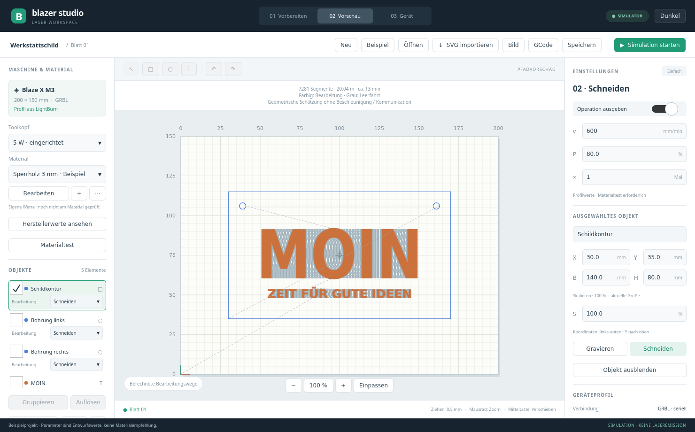

# Blazer Studio

Linux-Anwendung zum Vorbereiten und Steuern von Laserjobs auf Mathias’ BlazerX. Die Oberfläche orientiert sich an Aufbau und Bediengefühl von OrcaSlicer.

**Status:** Version 0.4 in C++20 / Qt Quick: Editor, Gruppen, Materialbibliothek, berechnete Schnitt-/Füllpfade, Vorschau, GCode-Export und GRBL-Anbindung. Verbindung, Referenzfahrt, 5-mm-Jog-Rückfahrt und ein vollständiger Kontur-Trockenlauf am M3 mit Laser-Aus bestätigt; reale Laser-/Materialbearbeitung noch nicht abgenommen.

**Lizenz:** [Source Available, ausschließlich nichtkommerziell und kostenlos weiterzugeben](LICENSE). Kommerzielle Nutzung einschließlich bezahlter Laserarbeiten ist ausgeschlossen. Diese Einschränkung entspricht keiner OSI-Open-Source-Lizenz. Qt und weitere Drittbestandteile behalten ihre eigenen Lizenzen; siehe [Hinweise](THIRD_PARTY_NOTICES.md).

## Entwurf starten

```bash
./run.sh
```

[Berechnete Jobs und Gerätebetrieb](docs/GRBL_WORKFLOW.md) · [Bedienung und Build](docs/PROTOTYPE.md) · [Objekte und Gruppen](docs/OBJECTS_GROUPS.md) · [Materialbibliothek](docs/MATERIAL_LIBRARY.md) · [Prüfbericht](docs/QA_REPORT.md) · [Importiertes Geräteprofil](docs/DEVICE_PROFILE.md) · [Materialreferenz des Herstellers](docs/MANUFACTURER_MATERIALS.md)



Auf Mathias’ Rechner ist der Startmenüeintrag **Blazer Studio** eingerichtet. Die Anwendung startet im Simulator. Im Gerätebereich kann ausdrücklich eine echte GRBL-Verbindung geöffnet werden; dort können die Aktionen reale Bewegung und Laserfreigabe auslösen. Siehe [Gerätebetrieb und Prüfumfang](docs/GRBL_WORKFLOW.md).

## Ziel

Ein angenehmer, moderner Arbeitsablauf für Gravieren und Schneiden: Werkstücke vorbereiten, Werkzeugwege prüfen und Jobs am Gerät ausführen. Eigenständige Implementierung; keine Portierung von LightBurn und keine Übernahme seines Quellcodes oder seiner Assets.

## Bedienkonzept

- Arbeitsbereiche **Vorbereiten · Vorschau · Gerät**.
- Große maßstäbliche 2D-Arbeitsfläche mit Raster, Zoom und direkter Objektbearbeitung.
- Geräte- und Materialprofile sowie Objektliste links; Bearbeitungsparameter rechts.
- Einstellungen in den Stufen **Einfach / Erweitert / Experte**.
- Schnitt- und Gravurebenen mit Leistung, Geschwindigkeit und Durchgängen.
- Vorschau mit Bearbeitungsreihenfolge, Fahrbewegungen und geometrisch geschätzter Laufzeit.
- Helles und dunkles Design, skalierbare Darstellung und Tastenkürzel.

## Zielumfang und Recherche

Mathias hat am 09.11.2026 den Funktionsumfang der aktuellen LightBurn-Version als Produktziel festgelegt. Referenz ist **LightBurn 2.2.01**, einschließlich Pro-Funktionen. Blazer Studio wird eigenständig und nativ für Linux entwickelt.

- [Funktionsumfang und Zielmatrix F01–F53](docs/LIGHTBURN_SCOPE.md): Editor, Vektor-/Rasterbearbeitung, Nesting, Kameras, Produktion und Gerätefunktionen.
- [Nutzerwünsche und Zusatzvorschläge Z01–Z13](docs/USER_WISHES.md): Quellen, heutiger Vergleichsstand und priorisierte Empfehlungen.
- [Entwicklungsplan](docs/ROADMAP.md): Umsetzung in Etappen; Spezialfunktionen werden nach tatsächlicher Hardwarefähigkeit bewertet.

Mehrseitige Projekte, True Nest, Mittellinien-Nachzeichnen und REST-API sind bereits Teil von LightBurn 2.2 und daher Vergleichsbasis. Der erste BlazerX-Prototyp ist ein Meilenstein auf dem Weg zum Gesamtziel. Der erste Entwurf deckt einen kleinen Teil des Zielkatalogs ab; zusätzliche Vorschläge sind noch keine beschlossenen Anforderungen.

## Technische Entscheidung

Festgelegt am 09.11.2026: **C++20** für den Anwendungskern, **Qt 6 / Qt Quick (QML)** für die Oberfläche und **CMake** als Buildsystem. Die konkrete Qt-Version wird bei Implementierungsbeginn geprüft.

Architekturempfehlung zur Abstimmung: objektorientierte Komponenten für Projektverwaltung, UI-Anbindung und Gerätekommunikation; wertbasierte Datenstrukturen und möglichst reine Funktionen für Geometrie und Werkzeugwegberechnung. Komposition bevorzugen, Vererbung gezielt für austauschbare Schnittstellen wie echten und simulierten Geräteadapter einsetzen.

Editor, Jobmodell, Werkzeugwegerzeugung und Geräteadapter sollen getrennt sein. Ein simulierter Geräteadapter ermöglicht die Entwicklung der Oberfläche vor der Hardwareanbindung.

## BlazerX-Unterstützung

Die installierte LightBurn-Konfiguration enthält das Profil **M3 / GRBL**, **200 × 150 mm**, seriell **115200 Baud**, S-Max **1000** und **2 %** für den Fokuspunkt; Z-Steuerung ist deaktiviert. Vorhandene Projekthinweise nennen das Gerät **Blaze X M3 / 5-W-Modul**. Siehe [Profilherkunft](docs/DEVICE_PROFILE.md). Firmwareversion, reale Controllerparameter und Abschaltverhalten sind noch live zu prüfen. Ausgelesene Einstellungen sind keine Live-Kompatibilitätsprüfung.

## Direkte Gerätefunktionen

Anforderung von Mathias (09.11.2026): Ein **Laserpunkt mit 2 % Sollleistung** zum Einstellen der Position und des Fokus gehört in den Gerätebereich.

- Gut erreichbare Funktion „Positionieren / Fokus – 2 %“ mit sichtbarer Leistungsangabe und Emissionsstatus.
- Standardbedienung als Gedrückthalten, ergänzt durch eine kurze maximale Einschaltdauer. Loslassen oder Ablauf fordert unmittelbar Laser-Aus an.
- Laserpunkt nur im verbundenen, betriebsbereiten Leerlauf freigeben; keine gleichzeitige Jobausführung. Vor Jobstart muss der manuelle Modus beendet und Laser-Aus bestätigt sein, soweit das Protokoll dies ermöglicht.
- Abbruch, Verlassen des manuellen Modus und Verbindungsfehler beenden die Freigabe. Nach Wiederverbindung keine automatische Reaktivierung. Bei Verbindungsverlust kann die Anwendung Laser-Aus nicht garantieren; geräteseitigen Watchdog beziehungsweise zeitbegrenzten Puls vor Umsetzung prüfen.
- 2 % beziehen sich auf den Sollwert des Controllers, nicht auf eine gemessene optische Leistung. Skalierung, Minimalleistung und mögliche Firmware-Untergrenzen am tatsächlichen BlazerX prüfen. Keinen ungeprüften Ersatz durch höhere Leistung vornehmen.
- Vorhandene Verriegelungen und Schutzfunktionen gelten auch im manuellen Modus. Niedrige Sollleistung ist keine Zusage für Augensicherheit.
- Ergänzende direkte Bedienung: X/Y-Schrittbewegungen mit wählbarer Schrittweite und Geschwindigkeit, Arbeitsnullpunkt setzen/anfahren und Rahmenfahrt. Referenzfahrt, Z-/Fokusverstellung, Air Assist oder Absaugung nur anbieten, wenn die Gerätefähigkeiten dafür nachgewiesen sind. Ein Fokuspunkt allein bedeutet keine motorisierte Fokusverstellung.

Der Simulator bildet Halten/Loslassen, Zeitlimit, Zustandswechsel, Jobkonflikte und Verbindungsfehler ab. Der Hardwareadapter enthält einen ausdrücklich ausgelösten kurzen 2-%-Puls; dessen optische Wirkung und Abschaltung sind noch real abzunehmen. Es erfolgt keine automatische Laserfreigabe beim Verbinden.

## Erste Ausbaustufe

SVG-/Bildimport, Objekttransformationen, Schnitt- und Füllpfade, gemeinsame Vorschau/GCode-Ausgabe und GRBL-Übertragung sind implementiert. Der Simulator spielt den Pfadsatz im Zeitraffer ab. Reale Bewegung wurde am eingerichteten M3 bestätigt; eine echte Bearbeitungsprobe folgt mit Material und betriebsbereiter Absaugung.

Bestehende Schutzfunktionen müssen erhalten bleiben. Erste Kommunikation und Bewegung werden ohne Laseremission geprüft; reale Bearbeitung folgt nach Validierung der Einheiten, Grenzen und Leistungsskalierung. Software-Abbruch ersetzt keinen Hardware-Not-Aus.

Die nächsten Schritte stehen in [docs/ROADMAP.md](docs/ROADMAP.md).

## Lizenz

**Source Available – nur nichtkommerzielle Nutzung und kostenlose Weitergabe.**

Es gilt die [Blazer Studio Noncommercial License 1.0](LICENSE). Änderungen und Weitergabe einschließlich Quellcode sind unter denselben Bedingungen erlaubt. Verkauf, entgeltlicher Zugang, kommerzielle Vermarktung und gewerblicher Einsatz für bezahlte Laseraufträge sind ausgeschlossen. Eigene Designs werden dadurch nicht automatisch unter diese Lizenz gestellt.

Wegen des Verbots kommerzieller Nutzung ist dies **keine OSI-Open-Source-Lizenz**. GitHub kann die eigene Lizenz als „Other“ anzeigen. Qt und andere Fremdbestandteile behalten ihre eigenen Rechte; siehe [Third-party notices](THIRD_PARTY_NOTICES.md). Die Anwendung nutzt dynamisch eingebundene Qt-Systembibliotheken; GPL-/LGPL-Texte liegen in `LICENSES/`.

Source available; noncommercial use and free redistribution only. See `LICENSE` for binding terms.
