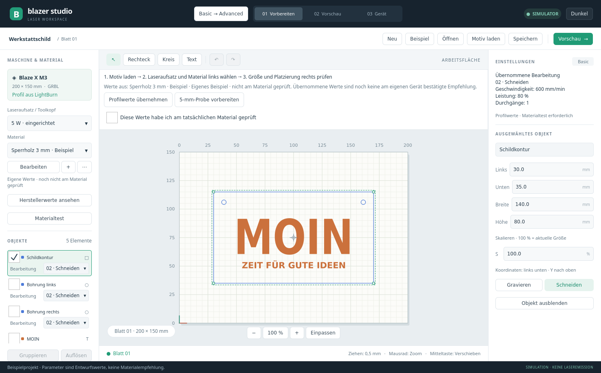
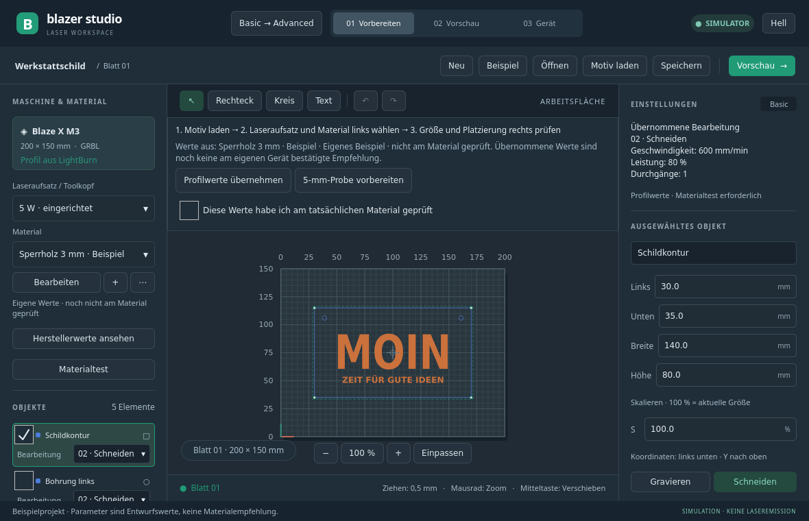
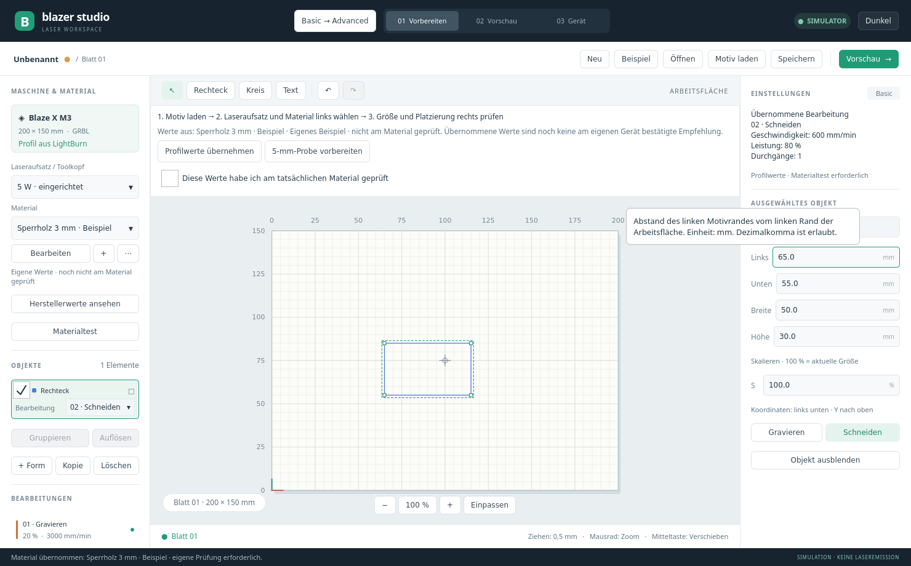

# Basic und Advanced (Version 0.7)

Blazer Studio startet in **Basic**. Oben schaltet **Basic → Advanced** die vollständige Oberfläche frei; **Advanced → Basic** führt zurück. Der Wechsel verändert weder Objekte noch Bearbeitungswerte. Ein Relief oder zusätzliche Operationen werden nicht automatisch vereinfacht: Basic erklärt, wenn der Auftrag in Advanced geprüft werden muss.

## Erster Auftrag

1. **Neu** beginnt ein leeres Projekt. Das anfängliche Werkstattschild ist ein Übungsprojekt mit Beispielwerten.
2. **Motiv laden** importiert ein Bild oder eine Vektorzeichnung. Rechteck, Kreis und Text lassen sich auch direkt anlegen.
3. Links den tatsächlich eingebauten **Laseraufsatz / Toolkopf** und das passende Material wählen. Der Kopf wird nicht automatisch erkannt. Die Materialliste zeigt nur Profile für die gewählte Nennleistung.
4. Rechts **Links**, **Unten**, **Breite** und **Höhe** in Millimetern einstellen. Der Ursprung liegt unten links. Die Auswahl erscheint gleichzeitig in Objektliste und Zeichenfläche.
5. **Vorschau** kontrollieren. Im Simulator heißt der nächste Schritt ausdrücklich **Am Bildschirm testen**; er bewegt keinen echten Laser.
6. Vor einem vollständigen Hardwareauftrag eine Materialprobe prüfen. **5-mm-Probe vorbereiten** erstellt dafür ein neues Projekt mit einer 5 × 5-mm-Fläche beziehungsweise Schnittkontur und den gewählten Profilwerten. Bei ungespeicherten Änderungen abbrechen und das Motiv speichern oder die Änderungen ausdrücklich verwerfen. Das Erzeugen der Probe startet keine Bearbeitung.
7. Im Gerätebereich den Laser bewusst verbinden, Material und Position vorbereiten, die Vorschau prüfen und den Auftrag ausdrücklich starten. Für den vollständigen Auftrag bestätigt der Anwender die tatsächlich erprobten Materialwerte. Diese Angabe ist eine persönliche Bestätigung, keine Messung des Programms.

Die Positions- und Fokusfunktionen wirken bei echter Geräteverbindung am Laser. Der 2-%-Punkt ist echte Laserstrahlung. Tooltips erklären die jeweilige Aktion einschließlich Bewegung beziehungsweise Laserfreigabe.

## Woher kommen die automatischen Werte?

Basic übernimmt **Geschwindigkeit, Leistung, Durchgänge, Linienabstand und aktivierte Bearbeitung** aus dem ausgewählten Profil. Die rechte Seite zeigt die tatsächlich verwendeten Werte mit Einheiten. Ein reines Gravurprofil ordnet vorhandene Objekte des aktiven Blatts der Gravur zu; ein Schnittprofil entsprechend dem Schnitt. Neue Formen erhalten ebenfalls die passende Zuordnung. Ein Motivimport in ein unverändertes Basic-Projekt übernimmt diese Zuordnung auch dann, wenn das Material schon vorher gewählt wurde. Fotos benötigen ein Gravurprofil.

Ab dem Entwicklungsstand beta.4-dev lädt **Motiv laden** auch begrenzte HPGL/PLT-, GCode-, RDWorks-Job- und unterstützte MillMage-Geometrie. RDWorks-Jobs werden als Pfade gelesen; ihre Maschinen- und Leistungswerte werden nicht übernommen. MillMage-Fräsoperationen werden nicht übernommen. Bei GCode entsteht ein editierbares Pfadobjekt; seine ursprünglichen Leistungen und Vorschübe werden nicht als Materialwerte übernommen. Die Datei wird nicht ausgeführt. [Unterstützte Befehle, Einheiten und Importgrenzen](VECTOR_IMPORTS.md) stehen separat. Diese Erweiterung ist noch nicht im unveränderten beta.3-Paket enthalten.

**Profilwerte übernehmen** entfernt individuelle Parameterabweichungen der Objekte auf dem aktiven Blatt; die Änderung lässt sich rückgängig machen. Die bloße Umschaltung des Modus tut das nicht. Erweiterte Werte wie Schnittfugenkorrektur, Einlauf, Überlauf oder Kreuzschraffur werden nicht versteckt als einfacher Standard ausgegeben; solche Projekte benötigen Advanced. Der Basic-Hardwarestart bleibt bei erkannten Profilabweichungen, erweiterten Einstellungen oder einem abweichenden ausgewählten Kopf gesperrt. Die Bildschirmprobe bleibt möglich. Die kleine ausdrücklich vorbereitete Probe ist auch ohne vorherige Materialbestätigung möglich.

Herstellerprofile sind **Ausgangswerte**, keine automatisch ermittelten Materialmessungen. Die Quelle steht im geführten Bereich und in der Bibliothek. Die vorhandenen Herstellerangaben betreffen M3 Pro, das eingerichtete Gerät heißt M3; diese Zuordnung ist weiter offen. Fehlende Gravur-Durchgänge werden sichtbar mit dem eigenen Anfangswert **1** ergänzt. Der anfängliche Gravurlinienabstand ist **0,1 mm** (254 dpi). Diese Ergänzungen sind keine Herstellerangaben. Eigene Profile lassen sich weiterhin bearbeiten.

Die persönliche Materialbestätigung wird bei geänderten Profil-/Operationswerten zurückgesetzt und nicht als Geräteabnahme gespeichert. Sie ersetzt keine Geräteverriegelung oder fachgerechte Vorbereitung.

## Hilfen und Bedienprüfung

Buttons, Auswahllisten, Eingabefelder, Menüs, Schalter und Regler besitzen Hilfetexte. Nach kurzem Verweilen erscheint die Erklärung; bei Tab-/Umschalt-Tab-Fokus ebenfalls. Zahlenfelder erläutern Bedeutung und Einheit und akzeptieren das Dezimalkomma. Bildhelligkeit, Schärfung und Nennleistung haben eigene Erklärungen, damit gleichlautende Kürzel nicht verwechselt werden.

Geprüft wurden helle und dunkle Ansichten in 1480 × 920 und 1180 × 760, vollständige Materialnamen, numerische Bedienung, Moduswechsel ohne Datenänderung, Profilübernahme, Abbruch/Erstellung der Probe und tatsächliche Tooltip-Anzeige per Tastatur. Der Hardwarestart wurde mit einem reinen Software-Testgerät geprüft, das keine serielle Schnittstelle besitzt. Die bisherigen Auswahl-, Gruppen-, Relief- und Schließen-Tests bleiben erhalten.

Das ist eine technische Bedienprüfung. Ob ein völlig unerfahrener Mensch ohne Hilfe zurechtkommt, muss noch mit echten Einsteigern beobachtet werden. Eine solche Nutzerstudie und die reale Materialabnahme werden durch diese Tests nicht behauptet.

In Advanced unter **05 Werkzeuge → Bild** kann genau ein ausgewähltes Rasterbild mit oder ohne aktuelle Korrekturen als PNG, JPEG oder BMP exportiert werden. Neue Eingaben vorher übernehmen. PNG erhält Transparenz; JPEG und BMP verwenden einen weißen Hintergrund. [Bildexport und Prüfumfang](RASTER_EXPORTS.md) beschreiben die Details. Diese Funktion gehört zur Entwicklung beta.4-dev, noch nicht zum unveränderten beta.3-Paket.

Unter der Objektliste stehen **Kopieren** und **Einfügen** bereit. Auf der Arbeitsfläche gelten Strg+C/X/V, Strg+Umschalt+V fügt Blazer-Objekte an der ursprünglichen Position ein. Native Kopien erhalten ihre zugeordneten Bearbeitungen; diese vor der Ausgabe prüfen. Textfelder behalten ihre eigenen Kürzel. [Zwischenablage und Grenzen](CLIPBOARD.md) gehören zur Entwicklung beta.4-dev, noch nicht zum beta.3-Paket.
