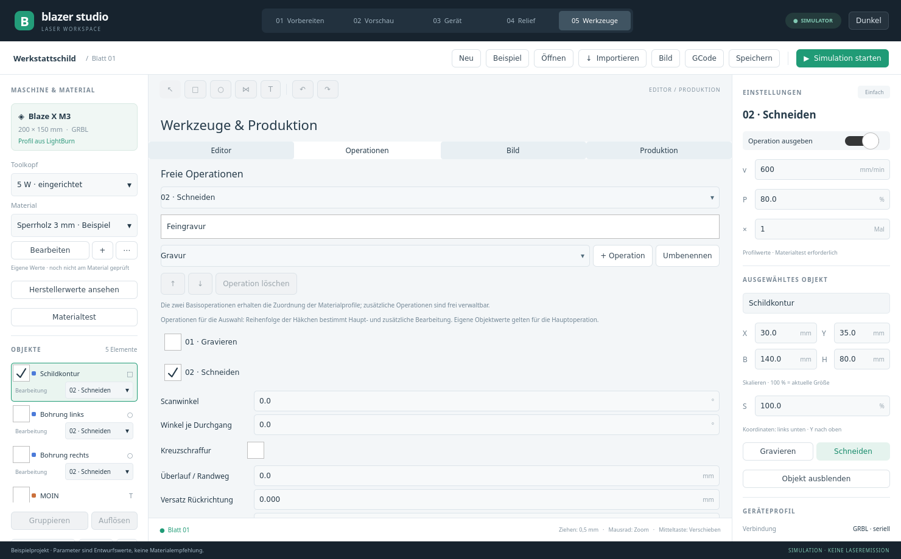
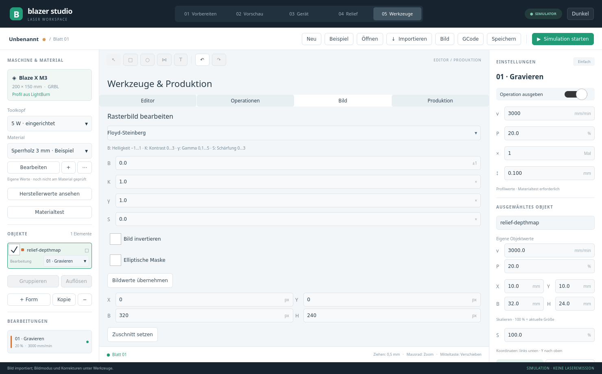

# Ausbaupaket 0.6 – Umsetzung und Grenzen

Auftrag vom 10.11.2026: die Lücken des Vergleichs gemeinsam bearbeiten und anschließend testen. Diese Tabelle beschreibt den tatsächlich gelieferten Umfang; sie behauptet keine vollständige LightBurn-Gleichwertigkeit.

| Bereich | Umsetzung | Grenzen |
|---|---|---|
| Datensicherung | Automatische Sicherung nach Änderungen, Wiederherstellungsangebot, vorherige Autosave-Datei, `.bak` vor Projektspeicherung | Noch keine verteilte Versionsverwaltung oder Zusammenarbeit mehrerer App-Instanzen |
| Operationen | Bis 64 benannte Operationen, Mehrfachzuweisung je Objekt, zusätzliche Operationen umsortieren/löschen | Zwei Basisoperationen bleiben für Materialprofile erhalten; eigene Objektwerte gelten für die Hauptoperation |
| Transformation | Drehen, Spiegeln, Ausrichten, Verteilen, numerische Werte; Raster und Fangpunkte an Objekt-/Arbeitsraumkanten und Mitten | Drehen/Spiegeln von Vektoren wandelt in Pfade um; Bilder haben eigene Werkzeuge |
| Vektoren | Linien/Bézier, Pfadumwandlung, Kontrollpunkte ziehen/numerisch ändern, Vereinigen/Differenz/Schnittmenge, Verbinden/Schließen/Zerlegen/Vereinfachen, Konturversatz | Kein vollständiger CAD-Skizzenlöser, keine parametrischen Bemaßungsbedingungen |
| Text | Systemschrift-/Stilwahl, Zeichenabstand, Text entlang eines ausgewählten Pfads | Pfadtext wird zu Konturen; keine vollständige Textverarbeitung |
| Import/Export | SVG, ASCII-DXF LINE/LWPOLYLINE/CIRCLE/ARC, PDF/AI/EPS über installiertes Inkscape, Rasterformate der installierten Qt-Plugins, STL/OBJ; SVG-Vektorexport | DXF-Sonderformen werden atomar abgelehnt. PDF/AI: erste Seite und vom Konverter unterstützte Varianten. SVG-Kompatibilität bleibt begrenzt; ununterstützte Clips/Rasterinhalte sperren Ausgabe |
| LightBurn-Migration | Geometrieimport für unterstützte Rechtecke, Ellipsen, Pfade, Texte/Backup-Pfade und Gruppen | Kein verlustfreier Projekt-/Bibliotheksimport; Geräteursprung/Spiegelung und Laserparameter müssen manuell geprüft werden |
| Bilder | Zuschnitt, Helligkeit/Kontrast/Gamma/Schärfung, Invertieren, Ellipsen-/Formmaske, Drehen/Spiegeln, Floyd-Steinberg/Atkinson/Schwellenwert, variable Graustufenleistung und Flächenvektorisierung | Maximal 512×512 im neuen Rasterworkflow; keine Garantie fotorealistischer Ausgabe auf unbekanntem Material |
| Schnittqualität | Vorzeichenbehaftete Schnittfuge für geschlossene Konturen, Haltestege, Ein-/Auslauf, Startpunktwahl | Alle zusätzlichen Wege müssen innerhalb der Arbeitsfläche bleiben; Ein-/Ausläufe sind tangentiale Geraden |
| Gravurqualität | Winkel, Winkel je Durchgang, Kreuzschraffur, Überlauf und manuell kalibrierbarer Rückrichtungsversatz | Reale Gerätekalibrierung steht aus; keine automatische optische Messung |
| Wege und Dauer | Gravur vor Schnitt, kleinere/innere Konturen, optional nähere Startpunkte/Objekte; Mindestzeit plus konservative Beschleunigungsschätzung | Begrenzte Suche statt global optimaler Wege; keine gemessene Laufzeitgarantie |
| Produktion | Konturbezogenes heuristisches Nesting, optionale 90°-Drehung, weitere Blätter, Rasterkopien, CSV-Textfelder/Seriennummern, QR und Stapel-GCode | Keine unbeaufsichtigte automatische Laserfolge, Nesting ist kein mathematisch optimales True Nest |
| Kalibrierung | Maß-/Rasterproben und markierte manuelle Fokusproben | Keine ungeprüften Firmwareänderungen; Fokus muss am vorhandenen Gerät manuell eingestellt werden |
| GRBL | Antwortquittierter RX-Puffer mit höchstens 100 unquittierten Bytes, neue Idle-Bestätigung, Live-Overrides mit `Ov`-Rückmeldung, verständlichere Fehler/Alarme | Erweiterte Anbindung im Emulator geprüft; Hardwareabnahme mit Emission bleibt offen |
| Relief | 16-Bit-Import, STL/OBJ-Oberseite als Tiefenbild, lokale KI-Fototiefenschätzung, abwechselnd 0°/90°, optionale Reinigungsschichten | KI schätzt relative Szenentiefe, keine gemessene Reliefgeometrie; Modell extern ausrichten; keine Z-Nachführung |
| Referenzfoto | Lokales Bild, vier Referenzpunkte, projektive Registrierung, abschaltbares Overlay | Keine Kamera angeschlossen, kein Livebild, keine automatische Linsenentzerrung; Registrierung derzeit sitzungsbezogen |
| Zusätzliche Hardware | Sichtbare Fähigkeitenmatrix für Kamera/Rotary/Z/Oberfläche/Absaugung | Beim M3 nicht vorhandene oder ungeklärte Funktionen bleiben gesperrt; keine geratenen Befehle |

## Bedienung

**05 Werkzeuge** enthält Editor, Operationen, Bilder und Produktion. Die Hauptansichten Vorbereiten/Vorschau/Gerät/Relief bleiben erhalten. Knoten können über „Knoten bearbeiten“ auf der Zeichenfläche gezogen oder im Werkzeugbereich numerisch geändert werden. Alt beim Verschieben unterdrückt die zusätzlichen Objekt-Fangpunkte.

Für Mehrfachbearbeitung im Bereich Operationen mehrere Häkchen setzen. Die erste Zuweisung ist die Hauptoperation. Gravieren und Schneiden können so denselben Vektor bearbeiten. Raster-/Reliefbilder dürfen nur Gravuroperationen verwenden.

CSV benötigt eine Kopfzeile. Textobjekte dürfen `{Spaltenname}` und `{number}` enthalten. Komma-/Semikolon-Dateien mit Anführungszeichen werden gelesen. Alle Zeilen werden vor dem Schreiben berechnet; vorhandene `job-NNNN.gcode` werden nicht überschrieben. Ein Stapel ist auf 64 MiB vorbereitetes GCode begrenzt. Keine automatische Hardwareausführung.

Beim Nesting werden ausgewählte Vektoren angeordnet; sichtbare nicht ausgewählte Vektoren bleiben Hindernisse. Bei Bedarf entstehen weitere Arbeitsblätter. Die Ausgabe betrifft ausschließlich das aktive Blatt. QR-Ruhezonen bleiben beim Packen erhalten; vollständig ausgewählte Gruppen werden als Einheit verschoben.

## Optionales lokales Foto-Tiefenmodell

```bash
python3 tools/setup_depth.py
```

Das installiert eine eigene Python-Umgebung und ein festgelegtes, prüfsummenüberwachtes ONNX-Modell in `$XDG_CACHE_HOME/blazer-studio/depth-runtime` (normalerweise `~/.cache/...`). Die Installation benötigt Internet. Die anschließende Berechnung unter **04 Relief → Foto → KI-Tiefenkarte** läuft lokal auf der CPU, ohne Bild-Upload. Ein Abbruchknopf und Zeitlimit sind vorhanden. Lizenz und Quellen siehe [Drittanbieterhinweise](../THIRD_PARTY_NOTICES.md).

Das Ergebnis ist eine relative Tiefenschätzung. Es muss auf unerwünschte Hintergründe, Löcher und falsche Tiefen geprüft und gegebenenfalls zugeschnitten/maskiert werden. Es ist keine Messung des Werkstücks oder verlässliche Rekonstruktion aller verdeckten Oberflächen.

## Dateiformat und Abnahme

Projektformat **6** speichert Arbeitsblätter, Operationen, Pfade, Bildoptionen und Reliefparameter; Formate 1–5 bleiben lesbar. Neu gespeicherte Dateien benötigen 0.6 oder neuer. Referenzfoto und seine Registrierung werden derzeit nicht in der Projektdatei gespeichert.

Reale Laser-/Materialprüfungen wurden für dieses Ausbaupaket nicht durchgeführt. Der Nutzer hatte kein Material eingelegt und den Gehäuselüfter ausgeschaltet. Softwaretests und Emulatorprüfungen ersetzen keine reale Emissions-/Materialabnahme. Kamera, zusätzliche Achsen und die separate Absaugsteuerung sind ohne nachgewiesene Hardware/Protokolle nicht freigegeben.





Nachweise: sieben CTest-Programme normal und mit ASan/UBSan bestanden, ergänzende QR- und Offline-Modellprüfung. Details im [Prüfbericht](QA_REPORT.md).
