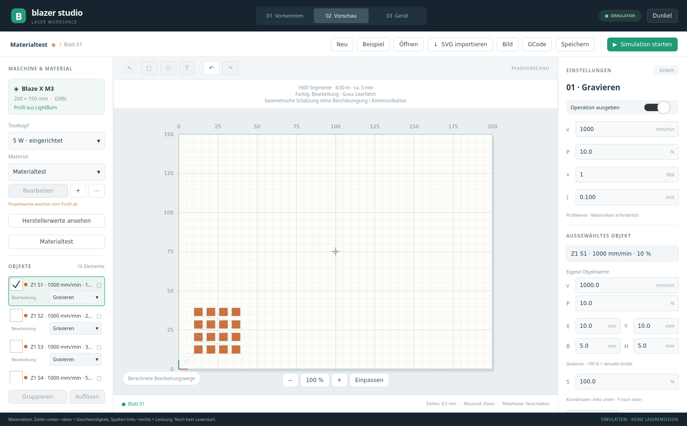

# Berechnete Jobs und GRBL – Version 0.5

Blazer Studio startet im **Simulator**. Eine echte Verbindung entsteht erst im Bereich **Gerät** durch Auswahl des seriellen Anschlusses und **GRBL verbinden**. Es gibt keine automatische Verbindung, Referenzfahrt oder Jobausführung beim Start.

## Projekt → Pfade → Vorschau → Ausgabe

- Rechtecke, Ellipsen, Textkonturen und unterstützte SVG-Vektoren werden in geometrische Pfade umgewandelt. Text verwendet dieselbe DejaVu-Sans-Darstellung wie der Editor.
- **Gravieren:** horizontale, abwechselnd gerichtete Fülllinien mit dem eingestellten Intervall. Innenräume bleiben nach der Füllregel frei.
- **Schneiden:** linearisierte Konturen mit eingestellten Durchgängen. Kleinere Begrenzungen werden vor größeren ausgegeben; dies ist noch keine vollständige Schnittreihenfolgenoptimierung.
- Die Vorschau zeichnet die berechneten Arbeits- und Leerfahrten. GCode und Live-Übertragung verwenden denselben eingefrorenen Pfadsatz. Die erste Leerfahrt wird ab Arbeitsnull dargestellt; beim realen Start kann die aktuelle Maschinenposition davon abweichen.
- Die Zeitangabe ist eine geometrische Schätzung aus Strecken und Vorschüben, mit angenommenen 3000 mm/min für Leerfahrten. Beschleunigung, tatsächliche Eilganggeschwindigkeit und Kommunikationspausen sind nicht eingerechnet.
- **GCode** exportiert einen GRBL-Job mit Millimetern, absoluten Koordinaten, G54, M4, S-Max 1000 und abschließend M5/S0. Die Datei enthält diese Voraussetzungen als Kommentar. Sie darf nicht ungeprüft auf anders konfigurierten Controllern ausgeführt werden.
- Die Simulation spielt die berechneten Bewegungen in 16 Sekunden ab. Ihr Zeitraffer ist keine Messung der tatsächlichen Jobdauer.

Aktive Objekte außerhalb von 200 × 150 mm, nicht auswertbare Inhalte oder zu komplexe Jobs verhindern die gesamte Ausgabe. Es werden keine stillschweigend unvollständigen Jobs exportiert. Grenzen: 500000 Bewegungssegmente, begrenzte SVG-/Bildgröße. SVG-Clips und eingebettete Rasterinhalte sind im Pfadkonverter noch nicht unterstützt. SVG-Dateien bleiben im Editor zusammenhängende Objekte. Farben werden nicht automatisch zu getrennten Laseroperationen.

## Bilder und Materialtests

**Bild** importiert PNG/JPEG/BMP als schwarzweiße Floyd-Steinberg-Dither-Geometrie. Transparenz wird gegen Weiß verrechnet; große Bilder werden auf maximal 600 × 600 Pixel verkleinert. Anfangsraster 0,1 mm pro Pixel; die Grafik kann anschließend skaliert werden. Das ist noch keine Graustufen-Leistungsmodulation oder vollständige Bildbearbeitung.

**Materialtest** erzeugt ein neues bearbeitbares Projekt: 2–10 Stufen je Achse, 5-mm-Gravurfelder mit 8 mm Abstand ab X10/Y10. Zeilen von unten nach oben ändern die Geschwindigkeit; Spalten von links nach rechts die Leistung. Die einzelnen Zellen besitzen eigene Leistungs-/Geschwindigkeitswerte, die rechts sichtbar und editierbar sind. Erzeugung allein startet keinen Laser. Vorschau, Projektdatei und GCode-Export funktionieren wie bei anderen Projekten.

Projektformat **5** speichert eigene Objektwerte und [Relief-Tiefenkarten](RELIEF.md). Formate 1–4 bleiben lesbar. Neu gespeicherte Dateien benötigen Version 0.5 oder neuer. Ein laufender übertragener Job bleibt unverändert, auch wenn der Editor danach geändert wird.



## Echte Verbindung

Die Anbindung prüft GRBL 1.1 beziehungsweise den am Blaze X gefundenen Grbl-ESP32-Fork 1.3a, `$30=1000`, `$32=1`, Statusausgabe in mm (`$13=0`), G54 und die hinterlegten 200 × 150 mm (`$130/$131`). Sie schreibt diese Firmwareeinstellungen nicht automatisch um. Erst ein passender Leerlauf mit bekannter Arbeitsposition erlaubt einen Job.

Die Übertragung sendet eine Zeile und wartet auf `ok`. Zusätzliche Status- und Meldungszeilen gelten nicht als Bestätigung. Nach der letzten Bestätigung wartet der Auftrag noch auf eine neue **Idle**-Meldung. Pause benutzt Feed Hold, Fortsetzen Cycle Start; Stop benutzt Feed Hold und Soft-Reset und setzt keinen Auftrag automatisch fort. Fehler, Alarm oder Kommunikationsausfall brechen die Host-Übertragung ab.

Jog verwendet relative `$J`-Bewegungen und begrenzt die Zielposition im Arbeitsraum. Rahmenfahrt benutzt Laser-Aus und Eilgänge. Referenzfahrt ist eine ausdrücklich ausgelöste Aktion bei aktiviertem Homing; **Arbeitsnullpunkt hier setzen** setzt X/Y in G54 am aktuellen Ort.

Der Hardware-Fokusknopf fordert einen **0,2-s-Puls mit S20 (2 % Sollwert)** an. Puls, Verweilen und M5/S0 werden gemeinsam in den RX-Puffer geschickt; Loslassen fordert einen Abbruch an, zusätzlich besteht ein Host-Zeitlimit. Ein beschädigter oder ausgefallener Kommunikationsweg kann keinen garantierten Laser-Aus-Befehl liefern. Die optische Wirkung und geräteseitige Abschaltung dieses Pulses wurden am realen Gerät noch nicht abgenommen. Absaugung und Lasermodulkühlung werden nicht als austauschbare Funktionen behandelt; keine ungeprüften Lüfterparameter werden umgeschrieben.

## Tatsächlich geprüfter Geräteumfang am 10.11.2026

Controller: **Blaze X M3_C_V01**, **Grbl-ESP32 1.3a.20211103**, 115200 Baud. Ausgelesen: S-Max 1000, Lasermodus an, mm, Homing an, Arbeitsraum 200 × 150 mm. Der eigene C++-Treiber hat Referenzfahrt, relative Fahrt nach X5/Y5 und Rückfahrt nach X0/Y0 controllerseitig bestätigt. Währenddessen wurden nur Laser-Aus-/Abfrage-/Bewegungsbefehle gesendet. Zusätzlich wurde ein vollständiger berechneter 5-mm-Quadratjob bei X10/Y10 mit jeder Laserfreigabe durch M5/S0 ersetzt übertragen, abgearbeitet und anschließend nach X0/Y0 zurückgefahren. Endzustand Idle und S0; keine unabhängige optische Leistungs- oder Maßmessung.

Der Nutzer hatte kein Material eingelegt und hat den Gehäuselüfter für Tests ohne Laseremission ausschalten lassen; Lüfter-Aus wurde von ihm bestätigt. Es wurde keine reale Gravur, kein Schnitt und kein Fokus-Laserpuls ausgeführt. Vor einer Bearbeitungsprobe sind passendes Material und betriebsbereite Absaugung erforderlich. Die Herstellerwerte für M3 Pro sind weiterhin keine abgeschlossene Materialvalidierung des vorhandenen M3.

Reproduzierbare Entwicklerprüfung, **mit mechanischer Bewegung nur bei ausdrücklich gewähltem `--motion` oder `--dry-job`**:

```bash
./build/blazer-grbl-probe /dev/serial/by-id/usb-1a86_USB_Serial-if00-port0
./build/blazer-grbl-probe /dev/serial/by-id/usb-1a86_USB_Serial-if00-port0 --motion
./build/blazer-grbl-probe /dev/serial/by-id/usb-1a86_USB_Serial-if00-port0 --dry-job
```

Das Prüfwerkzeug ist für diesen eingerichteten M3 bestimmt. Es setzt Homing und freien Bewegungsraum voraus; es enthält keine M3-/M4-Laserfreigabe. Es ersetzt keine Material- und Emissionsabnahme.

Protokollquellen: [GRBL Interface](https://github.com/gnea/grbl/blob/master/doc/markdown/interface.md), [GRBL Laser Mode](https://github.com/gnea/grbl/blob/master/doc/markdown/laser_mode.md), [Grbl-ESP32](https://github.com/bdring/Grbl_Esp32). Die Implementierung ist eigenständig; keine Firmwarequellen werden mitgeliefert.
