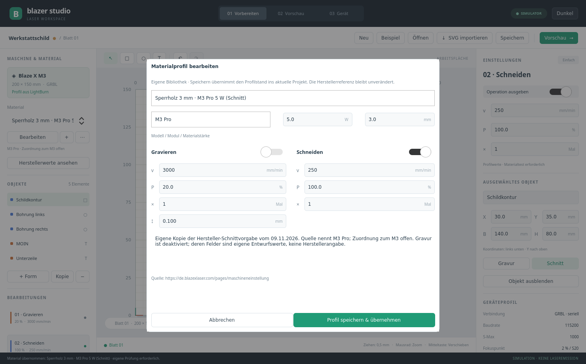

# Materialbibliothek

Links zuerst unter **Toolkopf** das Modul auswählen, anschließend unter **Material** ein passendes Profil. Standard ist das eingerichtete **5-W-Modul**. **1 W**, **5 W** und **10 W** stehen zur Auswahl; weitere in eigenen Profilen eingetragene Modulleistungen erscheinen ebenfalls. Die Materialliste enthält ausschließlich Profile mit exakt derselben Modulleistung. Bei unverändertem Startbestand sind dies 27 Profile für 5 W einschließlich Beispiel, 25 für 10 W und 13 für 1 W.

Ein Toolkopf-Wechsel filtert zunächst nur die Liste. Die bisherigen Projektparameter bleiben erhalten, bis ein Material ausgewählt wird; bei abweichendem Projektprofil wird dessen Modulleistung angezeigt. Ein angewendetes Profil einer anderen Leistung stellt den Filter entsprechend um. Beim Anlegen eines eigenen Profils wird der ausgewählte Kopf vorbelegt. Fehlen Profile für einen Kopf, lassen sie sich mit **+** anlegen.

Die Auswahlliste öffnet sich über der Arbeitsfläche mit bis zu 560 Pixeln Breite und bleibt innerhalb des Fensters. Lange Namen werden sowohl in der Liste als auch im geschlossenen Feld umgebrochen. Die Auswahl eines Profils übernimmt Gravur- und Schnittparameter samt Ausgabeschaltern ins aktuelle Projekt. **Bearbeiten** öffnet Namen, Maschinenmodell, Modulleistung, Materialstärke, Geschwindigkeit, Leistung, Durchgänge, Gravurintervall und Notizen. Dezimalkomma ist erlaubt.

**Profil speichern & übernehmen** speichert die Bibliothek und aktualisiert das Projekt. **Abbrechen** verwirft den Entwurf. **+** legt eine eigene Kopie an; im Menü **⋯** lassen sich Profile duplizieren und nach Bestätigung löschen. Auch eine vollständig geleerte Bibliothek erlaubt neue Profile.

Ausgeliefert werden **alle 64 Herstellerzeilen als auswählbare, bearbeitbare Profile** plus ein eigenes Beispiel: 5 W mit 15 Gravur- und 11 Schnittprofilen, 10 W mit 14 Gravur- und 11 Schnittprofilen sowie 1 W mit 13 Gravurprofilen. Die Namen enthalten Material, Modell, Modulleistung und Bearbeitung. Pro Profil ist nur die zugehörige Bearbeitung aktiviert. Die andere Bearbeitung bleibt mit eigenen Platzhaltern deaktiviert. Das 1-W-Modul erhält keine Schnittvorgaben.

Quelle ist die am 10.11.2026 erneut gelesene [Herstellerseite](https://de.blazexlaser.com/pages/maschineneinstellung); alle fünf Tabellen sind gegenüber dem vorherigen Abruf unverändert. Originalwerte, Tabellenbezeichnung, Datum und Quellenhash bleiben im Profil erhalten. Die vollständige Referenz unter **Herstellerwerte ansehen** bleibt ebenfalls verfügbar.

Gravur-Durchgänge stehen nicht auf der Seite. Im bearbeitbaren Profil wird deshalb **1 als eigener anfänglicher Arbeitswert** verwendet; die ursprüngliche Quellenangabe bleibt leer (`null`). Die Oberfläche zeigt dies bei der Auswahl an. Materialstärken werden nur aus ausdrücklich angegebenen mm-Werten übernommen; sonst bedeutet das Feld **0: nicht angegeben**. Fehlende Werte werden in den Notizen erklärt. Die bekannte Auffälligkeit „5 W / Sperrholz 10 mm / 1 Durchgang“ bleibt unverändert mit Hinweis erhalten. Die Herstellerseite nennt M3 Pro, das eingerichtete Gerät M3; die offene Modellzuordnung bleibt sichtbar.

Vorhandene Bibliotheken werden beim ersten Start mit dieser Erweiterung um fehlende Herstellerprofile ergänzt. Eigene Profile, geänderte Namen und Parameter bleiben erhalten; die bisherigen beiden Schnittprofile behalten ihre IDs. Vor der Ergänzung entsteht eine Sicherung `materials.json.before-manufacturer-v1.bak`. Nach der Ergänzung bewusst gelöschte Profile bleiben auch nach Neustart gelöscht.

Die Bibliothek liegt im Qt-Anwendungsdatenverzeichnis, auf diesem Rechner normalerweise `~/.local/share/BlazerStudio/Blazer Studio/materials.json`. Speicherung erfolgt beim Ändern atomar. Bei einer beschädigten oder unlesbaren Datei zeigt die App eine Meldung und überschreibt das Original nicht. Schreibfehler verändern den vorherigen Bibliotheksstand nicht.

Ein Projekt speichert eine eigene Kopie des angewendeten Profils. Spätere Bibliotheksänderungen oder Löschen verändern diesen Stand nicht automatisch; erneutes Auswählen übernimmt den aktuellen Bibliotheksstand. Individuelle Bearbeitungsänderungen werden als Abweichung angezeigt. Die Profilübernahme ist im Projekt rückgängig zu machen; Bibliotheksänderungen selbst haben keinen Undo-Verlauf.

Projektformat 7 speichert zusätzlich Relief-Tiefenkarten und eigene Objektwerte und weiterhin Objektgruppen und Mehrfachauswahl; Maße bleiben Millimeter mit Ursprung unten links. Projektdateien der Versionen 1, 2, 3, 4, 5 und 6 bleiben lesbar; Version 1 wird beim Öffnen umgerechnet. Profilrevisionen werden mitgeführt; eine vollständige Versionsverwaltung, Fotos, Suchfilter, Import/Export fremder Bibliotheken bleiben weitere Ausbauschritte; eine bearbeitbare Materialtestmatrix ist vorhanden.

Der **Materialtest**-Knopf erzeugt ein bearbeitbares Leistungs-/Geschwindigkeitsraster. Die Zellen zeigen rechts ihre eigenen Werte; Erzeugung allein startet keinen Job. Siehe [Workflow](GRBL_WORKFLOW.md).

Reliefbilder verwenden eigene Objektleistung/-geschwindigkeit sowie eigene Schichten und Raster. Ein Materialwechsel setzt ihren optionalen Abtrags-Kalibrierwert zurück. Siehe [Relief](RELIEF.md).

Seit 0.7 übernimmt Basic auch die passende Objektzuordnung und entfernt Parameterabweichungen auf dem aktiven Blatt. Advanced behält individuelle Objektwerte beim Materialwechsel. Details zu Quellen und Anfangswerten: [Basic](BEGINNER.md).
