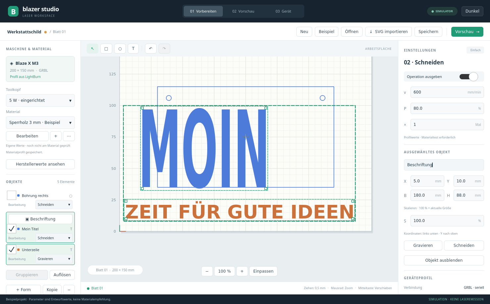

# Objekte und Gruppen

Ein Klick auf den **Objektnamen links** wählt das Einzelobjekt aus. Es wird in der Liste und mit einem grünen Rahmen auf der Zeichenfläche markiert. Die Liste scrollt zur Auswahl; falls nötig rückt die Zeichenfläche das Objekt ins Sichtfeld. Auch ausgeblendete ausgewählte Objekte erhalten im Editor eine schwache Darstellung mit Auswahlrahmen. In der Ausgabe bleiben sie ausgeblendet.

Rechts lassen sich **Name, X, Y, Breite und Höhe** ändern, bei Textobjekten zusätzlich der Textinhalt. X/Y beziehen sich auf die linke untere Ecke der Auswahl, alle Maße sind Millimeter. Breite und Höhe können unabhängig geändert werden. **Skalieren (%)** verändert beide Achsen proportional: 200 % verdoppelt die aktuelle Größe, 50 % halbiert sie; anschließend steht das Feld wieder bei 100 %. Dezimalkomma ist erlaubt.

Jede Objektzeile hat eine eigene Auswahl **Gravieren / Schneiden**. Sie verändert nur dieses Objekt. Die entsprechenden Schaltflächen rechts ändern die gesamte aktuelle Auswahl. Geschwindigkeit und Leistung bleiben die gemeinsamen Einstellungen der jeweiligen Bearbeitung; deren Ausgabeschalter gilt weiterhin. Unterschiedliche Bearbeitungsarten innerhalb einer Gruppe bleiben möglich.

## Gruppieren

1. Einen Objektnamen anklicken und weitere Objekte über die Häkchen links hinzufügen. Auf der Zeichenfläche erweitert Strg-/Umschalt-Klick die Auswahl.
2. **Gruppieren** anklicken. Der neue Gruppenname erscheint über den Mitgliedern. Beim Auswählen der ganzen Gruppe kann er rechts im Namensfeld geändert werden.
3. Den Gruppennamen links oder ein Mitglied auf der Zeichenfläche anklicken, um die gesamte Gruppe auszuwählen. Die grüne Umrandung zeigt ihre gemeinsamen Grenzen.

Eine Gruppe lässt sich gemeinsam ziehen, über X/Y platzieren, über Breite/Höhe oder Prozent skalieren und über **Kopie** beziehungsweise **−** kopieren oder löschen. Relative Positionen und Abstände skalieren mit. **Auflösen** entfernt die Gruppierung und erhält die Objekte und ihre Bearbeitungsarten. Jede Inhaltsänderung ist rückgängig zu machen.

Einzelmitglieder bleiben über ihren Objektnamen links erreichbar; auf der Zeichenfläche wählt Alt-Klick ein einzelnes Gruppenmitglied. Gruppen sind zunächst flach. Erneutes Gruppieren ordnet die gewählten Mitglieder einer neuen Gruppe zu, statt verschachtelte Untergruppen anzulegen.

Projektformat **3** speichert Gruppen, Mitgliedschaften, Namen und Mehrfachauswahl. Dateien der Formate 1 und 2 werden weiter gelesen. Neu gespeicherte Dateien benötigen den neuen Programmstand. SVG-Import bleibt eine zusammenhängende Grafik; die Gruppierungsfunktion zerlegt SVG-Inhalte nicht automatisch.

