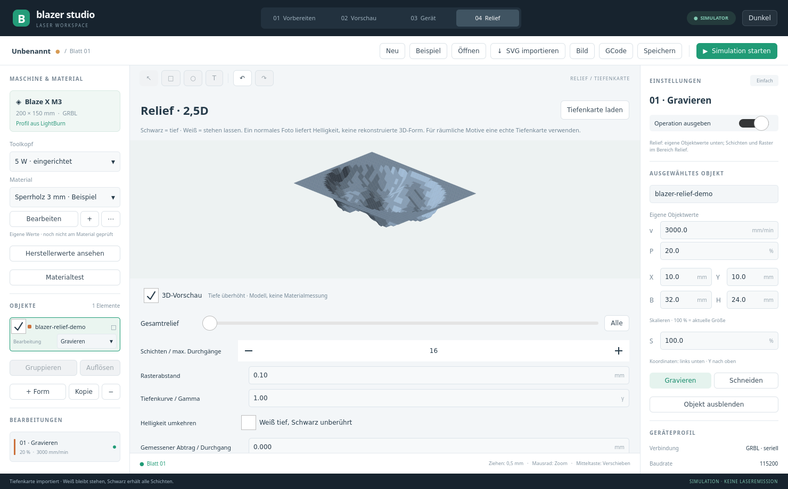

# Reliefgravur aus Tiefenkarten – Version 0.6

Der eigene Arbeitsbereich **04 Relief** berechnet mehrere Gravurschichten aus den Grauwerten eines Bildes. Es handelt sich um 2,5D: XY-Bearbeitung in mehreren Durchgängen, ohne automatische Z-Nachführung. Die optionale lokale Foto-Tiefenschätzung erzeugt eine relative Tiefenkarte; sie ist keine Vermessung des Werkstücks.

## Vorhandene Verfahren und Grenzen am Stein

[LightBurn 3D Sliced](https://docs.lightburnsoftware.com/latest/Guides/3DSlicedImage/) verwendet Tiefenkarten: dunkle Stellen erhalten mehr Durchgänge, helle weniger. LightBurn bietet diesen Modus für Galvos an und weist darauf hin, dass er keine präzise Gravurtiefe garantiert. Die eigenständige Blazer-Studio-Implementierung erzeugt stattdessen GRBL-XY-Jobs für den vorhandenen Adapter; dies ist keine Übernahme von LightBurn-Code.

Ein Tiefenbild unterscheidet sich von einem Foto: Ein Schatten ist kein geometrisches Loch. Für ein reliefartiges Gesicht oder Motiv sollte eine eigens erzeugte Höhen-/Tiefenkarte verwendet werden. Schwarz bedeutet hier maximalen Abtrag, Weiß unveränderte Oberfläche; Karten mit der umgekehrten Konvention lassen sich invertieren.

Die [Stein-Hinweise von Boss Laser](https://team.bosslaser.com/applications/glass-stone/stone-slate-and-tile/) beschreiben hauptsächlich oberflächliche helle Markierungen durch CO₂-Laser und materialabhängige Ergebnisse; ein sichtbares Foto auf Stein ist deshalb kein Nachweis eines tiefen Reliefs. Daraus lässt sich insbesondere keine Abtragsleistung des vorhandenen blauen M3-Diodenmoduls ableiten. **Fühlbare Reliefgravur auf Kieseln ist am M3 noch nicht erprobt.** Bei einem gewölbten Kiesel ändern sich außerdem Oberfläche und Fokus über das Motiv. Diese Version vermisst oder kompensiert die Krümmung nicht.

## Bedienung

1. Bei einem reinen Reliefauftrag mit **Neu** beginnen. Import fügt ein Objekt zum offenen Projekt hinzu und entfernt vorhandene Objekte nicht.
2. **Advanced → 04 Relief → Tiefenkarte laden**. Unterstützt: PNG, JPEG, BMP, maximal 4096 Pixel je Seite und 16 MiPixel; keine automatische Verkleinerung. Zusätzlich gelten die [Speichergrenzen](RASTER_QUALITY.md). PNG vermeidet JPEG-Artefakte. Verarbeitung und eingebettete Speicherung erhalten auch 16-Bit-Graustufen mit Transparenz. Es wird kein Dithering angewandt.
3. X/Y, Breite und Höhe rechts einstellen. Das neue Bild beginnt bei X10/Y10 mit höchstens 100 mm an der längsten Seite (bei kleinen Bildern 0,1 mm je Bildpixel). Leistung und Geschwindigkeit sind eigene Objektwerte rechts; Importwerte sind Entwurfswerte des Projekts, **keine Steinempfehlung**.
4. Schichtzahl **1–256**, Raster **0,02–2 mm**, Tiefenkurve/Gamma **0,1–5** einstellen. Gamma > 1 verringert die Bearbeitung mittlerer Grauwerte, Gamma < 1 verstärkt sie. **Helligkeit umkehren** tauscht Schwarz-/Weißbedeutung. Vollständig transparente Pixel bleiben immer unbearbeitet.
5. **3D-Vorschau** zeigt die quantisierte relative Abtragsform mit überhöhter Tiefe. Ohne Haken erscheint die Graustufen-Draufsicht. Der Schichtregler zeigt ab Schicht 1 die tatsächlich aktive Maske orange; 0/Alle zeigt das Gesamtrelief. Das ist eine Sollgeometrie, keine Messung oder Simulation des Materials.
6. **Vorschau** zeigt den gesamten berechneten Job einschließlich anderer aktiver Objekte und Leerfahrten. **GCode** exportiert denselben Pfadsatz; Simulator und GRBL-Adapter verwenden ihn ebenfalls. Kein automatischer Laserstart durch Import oder Parameteränderung.



Zum Ausprobieren liegt eine selbst erzeugte [synthetische Tiefenkarte](../assets/relief-depthmap.png) bei. Sie enthält keine gemessene Steinstruktur und keine vorgegebenen Laserparameter.

## Berechnung

Für 8-Bit-Grauwerte `g` von 0 bis 255 gilt die folgende Formel; 16-Bit-Werte werden entsprechend durch 65535 normalisiert. Gamma `γ`, maximale Schichtzahl `N`:

```text
Normal:    Schwärzung = 1 − g / 255
Invertiert: Schwärzung = g / 255
Durchgänge = ceil(N × Schwärzung^γ)
```

Die Werte werden auf 0…N begrenzt; Weiß bleibt normal bei null. Teiltransparenz wird vor der Tiefenumkehr gegen Weiß verrechnet, vollständig transparente Pixel bleiben unabhängig von der Umkehr bei null. Bei Gamma 1 und 16 Schichten erhält Schwarz 16 Durchgänge, Grau 128 acht und Weiß keinen.

Schicht k bearbeitet alle Rasterzellen mit mindestens k Durchgängen. Zuerst wird die ganze erste Schicht abgeschlossen, dann die zweite usw. Zusammenhängende aktive Zellen einer Zeile werden zu einer Strecke zusammengefasst; die Scanrichtung wechselt. Jede Schicht verwendet die eigene konstante Leistung und Geschwindigkeit des Objekts. Die normalen Ebenenparameter für Wiederholungen und Intervall werden für Reliefbilder nicht zusätzlich angewandt. Reliefbilder können nicht als Schnittkontur zugewiesen werden. Reliefbearbeitung findet vor normalen Vektoroperationen statt; normale Schnittkonturen bleiben zuletzt.

Das Raster wird in beiden Achsen mit dem eingestellten Abstand abgetastet; Bilddaten werden an Zellmittelpunkten ohne Dithering gelesen. Die oberste/rechteste Randzelle kann schmaler sein. Intervalländerungen beeinflussen Auflösung, Energie je Fläche und Laufzeit. Schichtkommentare im GCode dienen der Nachvollziehbarkeit; es werden keine Z-Kommandos erzeugt.

## Kalibrierte Tiefenschätzung

**Gemessener Abtrag / Durchgang** bleibt anfangs **0**: keine Kalibrierung und keine Angabe einer tatsächlichen Tiefe. Nach einer eigenen Messung mit demselben Material, Laser, Fokus, Raster, Leistung und Geschwindigkeit kann ein Wert eingetragen werden:

```text
geschätzte lokale Tiefe = berechnete Durchgänge × gemessener Abtrag je Durchgang
maximale Tiefenschätzung = N × gemessener Abtrag je Durchgang
```

Beispiel ausschließlich zur Rechnung: 16 × 0,02 mm ergibt 0,32 mm geschätzten Maximalabtrag. **0,02 mm ist kein Messwert des M3 und keine Empfehlung für Kiesel.** Die Näherung nimmt konstanten Abtrag an; Fokusänderung, Materialinhomogenität und nichtlinearer Abtrag können das Ergebnis verändern. Änderungen an Objektleistung, Objektgeschwindigkeit, Relief-Raster oder angewendetem Material setzen die Kalibrierung zurück; Undo stellt den vorherigen Zustand wieder her.

## Projekte, Grenzen und Prüfung

Format **7** speichert Tiefenkarte, Objektparameter, Schichten, Gamma, Umkehr und Kalibrierwert direkt im Projekt. Alte Formate 1–6 bleiben lesbar; neu gespeicherte Dateien benötigen Version 0.7 oder neuer. Kopien teilen nur unveränderliche Bilddaten, Einstellungen bleiben unabhängig. Änderungen sind mit Undo/Redo rückgängig zu machen, numerische Transformation und Gruppen funktionieren weiter.

Grenzen: höchstens eine Million Rasterzellen und 20 Millionen Raster-/Schichtprüfungen pro Gesamtjob, 500000 Bewegungen pro Gesamtjob und insgesamt 40 MiB eingebettete Grafiken sowie 32 MiPixel dekodierte Bilder. Überschreitung, ungültige Parameter oder aktive Objekte außerhalb 200 × 150 mm sperren den gesamten Export/Job. Gröberes Raster, kleinere Abmessungen oder weniger Schichten reduzieren den Aufwand. Das Zeitmodell enthält eine pauschale konservative Beschleunigung, aber keine gemessenen Kommunikationszeiten.

Automatisiert geprüft: Schwarz/Weiß/Grau, Gamma, Umkehr, Transparenz, tatsächliche Besuche je Zelle/Schicht, Bildorientierung, Schnittreihenfolge, unveränderte Weißflächen, Speichern/Laden, defekte Bilddaten, Komplexitäts-/Arbeitsraumgrenzen, gemeinsame Bilddaten bei unabhängigen Kopien, Undo und Kalibrierungsrücksetzung. UI-Test bedient Reliefnavigation, Umkehr und Gamma mit Dezimalkomma und prüft die Tiefenanzeige. Reale Reliefgravur und Abtragskalibrierung bleiben offen; während dieser Entwicklung wurden keine Hardwarebefehle ausgeführt.

Zusätzlich verfügbar: 16-Bit-Tiefenkarten, STL-/OBJ-Oberseiten, optionale lokale Foto-Tiefenschätzung, Wechsel zwischen horizontalen und vertikalen Schichten und regelmäßige Reinigungsschichten mit eigener Leistung. Nicht enthalten: Oberflächenvermessung und Z-Fokusnachführung. [Bedienung und Modellinstallation](EXPANSION.md).

Reinigungsschichten bearbeiten die aktuelle Schichtmaske zusätzlich. Sie beeinflussen den tatsächlichen Abtrag. Änderungen an Reinigung oder Schraffurrichtung setzen einen vorhandenen Kalibrierwert zurück. Eine erneute Messung muss mit genau diesem Ablauf erfolgen; die lineare Tiefenangabe bleibt eine Näherung.
